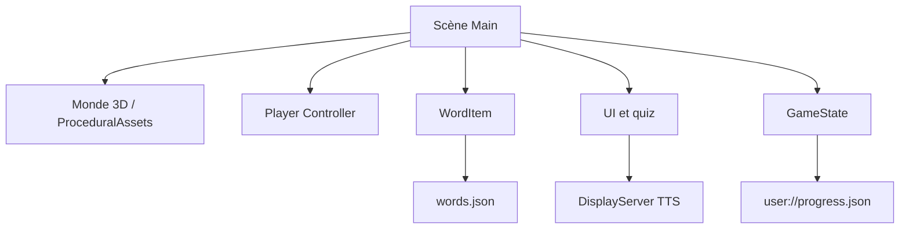

# Architecture technique

| Module | Responsabilité |
|---|---|
| `main.gd` | Orchestration du monde, cible courante, quiz, feedback, UI. |
| `player_controller.gd` | Déplacement 3e personne, caméra, collision et limites. |
| `procedural_assets.gd` | Modèles low-poly et décors générés localement. |
| `word_item.gd` | Objet de vocabulaire, animation flottante et état collecté. |
| `game_state.gd` | Progression locale, étoiles et sauvegarde JSON. |
| `words.json` | Anglais, français, catégorie et coordonnées. |

## Flux pédagogique
1. Chargement du vocabulaire et création des objets 3D.
2. Affichage du premier mot français à rechercher.
3. Détection de proximité et interaction avec E.
4. Présentation de trois réponses anglaises.
5. Feedback immédiat et réessai en cas d'erreur.
6. En cas de succès : sauvegarde, prononciation puis objectif suivant.

## Décisions
- Godot 4.x + GDScript pour limiter les dépendances.
- `CharacterBody3D` pour le personnage.
- Meshes low-poly pour maintenir des coûts graphiques réduits.
- Vocabulaire séparé du code pour faciliter les extensions.
- TTS système et fallback texte.
- Sauvegarde dans `user://`, sans compte ni serveur.

## Limites du MVP
- Contrôles clavier; le tactile est au backlog.
- Une leçon de huit mots.
- Modèles procéduraux simples, non animés.
- TTS dépendant des voix installées sur la machine.
- Espace adulte, statistiques avancées et nouveaux thèmes non livrés.
