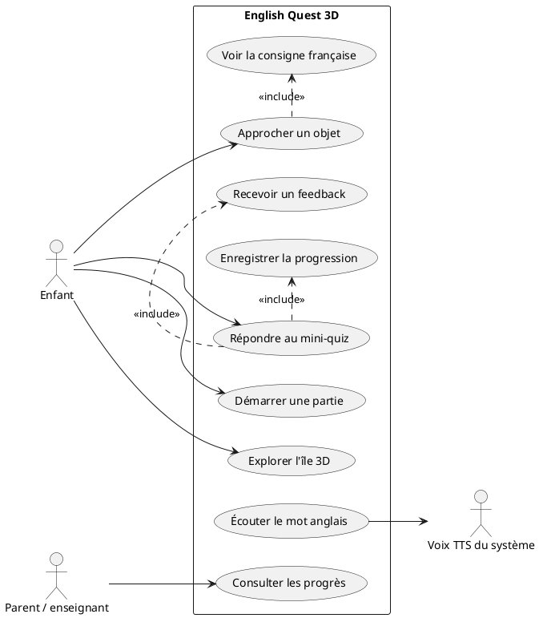

# Cas d'utilisation — English Quest 3D

## Acteurs
- **Enfant :** explore, découvre, écoute et répond.
- **Parent / enseignant :** consulte la progression (future version).
- **Système TTS :** prononce le vocabulaire à la demande.
- **Stockage local :** conserve les mots appris.

## Diagramme PlantUML

## Fiches de cas d'utilisation

### UC-01 — Démarrer une partie
**Acteur :** enfant. **Précondition :** application lancée.  
Le jeu charge l'île, lit la progression locale et affiche le premier objectif.
Sans sauvegarde existante, une progression vide est initialisée.

### UC-02 — Explorer l'île
**Acteur :** enfant. **Précondition :** partie active.  
L'enfant déplace son personnage; la caméra le suit; deux zones sont identifiées
par des panneaux. Les limites du terrain empêchent de sortir de l'île.

### UC-03 — Interagir avec un objet
**Acteur :** enfant. **Précondition :** un objet est proche.  
L'enfant appuie sur E. Si l'objet correspond au mot demandé, le quiz apparaît.
Sinon, le jeu rappelle doucement l'objectif français.

### UC-04 — Répondre au mini-quiz
**Acteur :** enfant. **Précondition :** quiz affiché.  
L'enfant choisit une traduction anglaise parmi trois options. Une réponse
correcte valide le mot et passe au suivant; une erreur autorise une nouvelle
tentative sans retirer de points.

### UC-05 — Écouter le mot
**Acteurs :** enfant et TTS. **Précondition :** un mot est actif.  
L'enfant clique sur le bouton d'écoute; le système prononce le mot si une voix
anglaise existe. Sinon, le texte reste disponible et le jeu continue.

### UC-06 — Enregistrer la progression
**Acteur :** système. **Précondition :** nouvelle réponse correcte.  
Le mot appris et le nombre d'étoiles sont enregistrés dans un fichier JSON
local. En cas d'échec d'écriture, le jeu continue avec un avertissement.

### UC-07 — Consulter les progrès (futur)
**Acteur :** parent ou enseignant. **Précondition :** espace adulte développé.  
L'adulte consulte les mots appris et les leçons terminées sans envoi de données
personnelles vers un serveur.
